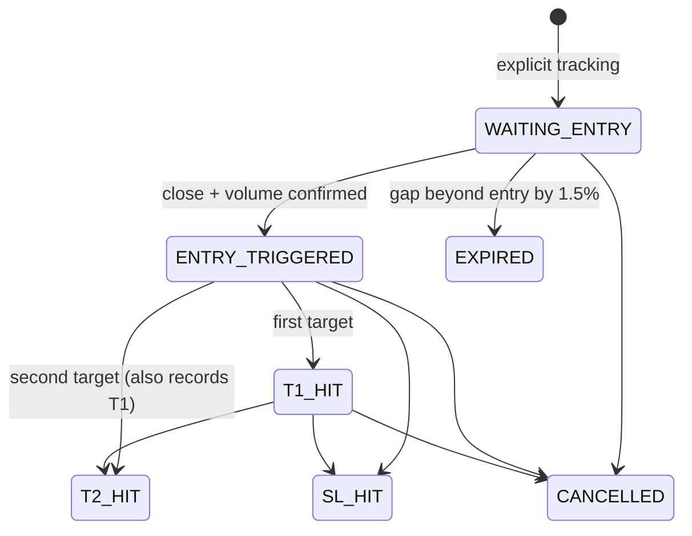

# Implementation and boundaries

## Structure

```
android/app/src/main/java/com/foscreener/app/
  MainActivity.kt       Compose screens + candle/volume chart
  CompassViewModel.kt   lifecycle state + retrying WebSocket
  Repository.kt         HTTP, private scan cache, local preferences
backend/app/
  main.py               FastAPI + WebSocket + paper replay
  provider.py           provider protocol + synthetic NSE sample
  analysis.py           causal daily indicators, setup, scoring helpers
  rules.py              validated JSON configuration
  engine.py             transactional SQLite trade/event engine
backend/tests/          indicators, risk, triggers, API and socket tests
```

The Android foundation uses MVVM, Material 3, OkHttp, Coroutines/StateFlow and lifecycle-aware collection. It uses explicit dependency construction and a private JSON cache rather than Hilt, Retrofit and Room. These are deliberate initial implementation choices, not claims that those requested integrations exist. No secrets are stored on the phone. The chart is a Compose Canvas and has no third-party WebView scripts.

## Paper lifecycle



SQLite `trades` contains symbol, direction, state, planned levels, quantity, last replay price and creation timestamp. `events` contains trade_id, event, actual event price, UTC time and message. `(trade_id,event)` is unique; updates and event insertion share one transaction, protected by a process lock. Terminal trades ignore later ticks. This engine is single-process: do not run multiple Uvicorn workers. Server monitoring is replay-driven, not a subscribed live feed. Entry events record actual replay prices; the trade's entry field remains the planned entry. The engine stores actual replay entry fills and terminal exit prices. Paper P&L uses those fills and underlying quantity before costs; open positions show unrealized mark-to-replay-price P&L. Cancellation stops tracking and does not pretend a broker exit occurred.

For OHLC replay, existing positions hit stops before targets when both are in the bar. Gap stops record actual closing replay prices when worse than the stop. A newly triggered entry is not also evaluated against the same bar extremes: execution ordering is ambiguous. This is not a tick-accurate broker simulator. Volume/close flags are supplied by replay callers; a real adapter must derive them from validated candles. Entry-near, entry, targets, stops, gap skip and cancellation events are persisted, but trailing stops, options events and time-based expiry are not implemented.

## Before live or production use

The uploaded document is a product specification, not evidence of working services. Outstanding work is explicit:

- Licensed broker adapter: authenticated REST history, WebSocket ticks, instrument master and legal data entitlements; complete NSE/BSE universe; real options chains and lot/expiry metadata.
- Exchange calendars (including special sessions), corporate actions, adjusted candles, halts, ban lists, freshness validation, reconnect sequence checks and replay-safe tick ordering.
- Missing indicators: ADX, Bollinger Bands, VWAP, Supertrend, OBV, volume profile, delivery, pattern detection; fundamental data and event/context filters.
- Walk-forward analysis, sector/market aggregates, realistic execution costs, portfolio accounting, correlation/sector concentration and daily-loss enforcement. Current risk limits are per-trade 2%, capital affordability and five active trades, not a complete risk engine.
- Durable job queue, market-hours scheduler, historical recalculation, provider rate limits/retry and distributed cache. The five-second demo socket publishes static-data snapshots; it does not run an exchange scanner.
- Per-user authentication and authorization, encrypted broker token vault, tenant isolation, audit trail, HTTPS deployment, migrations/backups and secret rotation.
- Server-side FCM token registration, authenticated subscriptions, delivery retries, user preferences, quiet hours, event batching/debounce, foreground notification channels/actions/deep links and Android notification permission. No background foreground-service workaround is used; server-side FCM delivery is the appropriate eventual architecture.
- Option premium risk sizing, Greeks/IV validation, spreads, slippage/circuit handling; live execution remains disabled.
- Room schema/migrations, Hilt/Retrofit if desired, journal/P&L/equity curve, CSV/PDF, watchlists/cloud sync, Hindi translations, widgets, biometrics and crash reporting with consent.
- Instrumented Android UI tests, device and lifecycle tests, accessibility audit, 200-stock/1,000-user load testing, release signing and distribution. Do not interpret backend tests as these checks.

Broker and Firebase credentials should be supplied securely only after selecting integrations. Never commit them or send them through chat. Automatic real-order placement should remain off by default and require explicit trade confirmation if implemented.
